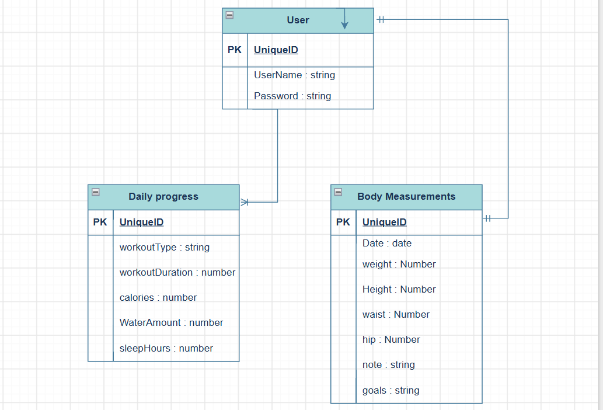

[ FitTrack ]

FitTrack is a web-based fitness management application that helps users track workouts, record body measurements, manage fitness goals, monitor nutrition and water intake, and analyze their progress over time.

Project structure

3 MAIN MODULES

1. daily progress: workouts he did, water he intake, sleep
2. Body Measurements: height, weight, hips ,goals 
3. user 

FitTrack – User Stories
1. Body Measurements: height, weight, hips ,goals 

As a user, I want to record my body weight so that I can monitor my weight changes.
As a user, I want to record my height so that I can maintain my body information.
As a user, I want to record my waist and hip measurements so that I can track body changes.
As a user, I want to add notes to my measurement records so that I can save additional information
As a user, I want to view my measurement history so that I can compare previous measurements.
As a user, I want to edit my body measurements so that I can correct or update my records.
As a user, I want to delete measurement records so that I can remove incorrect entries.
As a user, I want to record my fitness goals so that I can keep track of my targets.

2. daily progress: workouts he did, water he intake, sleep

As a user, I want to record my workout type so that I can track my physical activities.
As a user, I want to record my workout duration so that I can monitor my training time.
As a user, I want to record calories burned so that I can monitor my workout performance.
As a user, I want to record my daily water intake so that I can track my hydration.
As a user, I want to record my sleep hours so that I can monitor my sleeping habits.
As a user, I want to view my daily progress records so that I can review my activities.
As a user, I want to edit my daily progress records so that I can correct incorrect information.
As a user, I want to delete daily progress records so that I can remove unwanted entries.

#ERD

